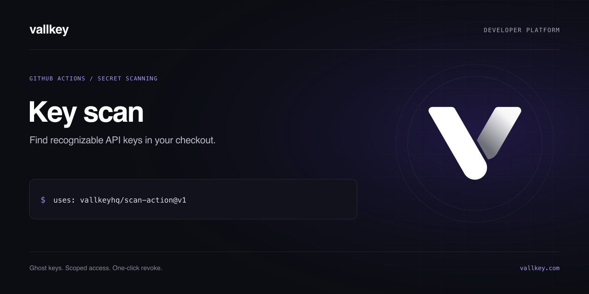

[](https://github.com/vallkeyhq/scan-action/actions/workflows/checks.yml)
[](https://github.com/vallkeyhq/scan-action/actions/workflows/secrets.yml)
[](LICENSE)

# Vallkey key scan

Scan a GitHub checkout for recognizable API keys using the [Vallkey CLI](https://www.npmjs.com/package/vallkey). Findings produce masked line annotations and a job summary. No Vallkey account or API token is required for scanning.

## Usage

```yaml
name: API keys
on: [push, pull_request]
permissions:
  contents: read
jobs:
  scan:
    runs-on: ubuntu-latest
    steps:
      - uses: actions/checkout@3d3c42e5aac5ba805825da76410c181273ba90b1
        with:
          fetch-depth: 0
          persist-credentials: false
      - uses: actions/setup-node@949feb2413d6458794dcd2491c4babbbce0c15c1
        with:
          node-version: '22'
          package-manager-cache: false
      - uses: vallkeyhq/scan-action@v1
        with:
          history: 'true'
```

For an immutable workflow, replace this action’s `@v1` reference with the full commit SHA of the release you reviewed. The `v1` tag can move. npm access is required to install the pinned scanner version.

## Inputs and outputs

| Input       | Default | Behavior                                                                       |
| ----------- | ------- | ------------------------------------------------------------------------------ |
| `path`      | `.`     | Folder or file to scan, relative to the working directory                      |
| `history`   | `false` | Scan the checked-out Git history; use `fetch-depth: 0` for complete history    |
| `fail`      | `true`  | Fail on findings; `false` reports findings while operational errors still fail |
| `allowlist` | Empty   | Optional JSON file of exact path, SHA-256 value digest and reason exceptions   |
| `version`   | `0.8.1` | Exact stable version of the `vallkey` npm package                              |

`found` is the number of finding annotations emitted by the scanner. `history` and `fail` accept only `true` or `false`. Paths are passed as arguments, not executed as shell code.

The `allowlist` input requires a CLI version that supports `scan --allowlist`; the default version does. An entry suppresses only the exact matched value in the exact relative path. Review exceptions carefully. A `vallkey:ignore` comment suppresses scanning on that line.

## Scope

This is a pattern-based scanner, not a guarantee that a repository contains no secrets. Unrecognized credential formats, skipped binary or oversized files, unavailable history, and ignored lines can escape detection. Review its findings alongside other security controls. The scanner masks recognized values in its normal output; never paste credentials into issue reports or logs.

The action does not authenticate to Vallkey or upload repository source to the Vallkey service. npm package installation requires network access. Use a runner with Bash and Node.js 18 or later; Node.js 22 or later is recommended.

## If a key is found

Revoke or rotate it at the provider, inspect its usage, and remove it from the current source. Removing a key from a later commit does not erase earlier exposure. If desired, use Vallkey ghost keys to apply permissions and limits to future application requests.

## Development

```sh
npm ci
npm run typecheck
npm test
```

Tests execute the actual composite-action shell with a local scanner stub, without installing npm packages or contacting provider APIs. See [CONTRIBUTING.md](CONTRIBUTING.md), [SECURITY.md](SECURITY.md), and [LICENSE](LICENSE).
